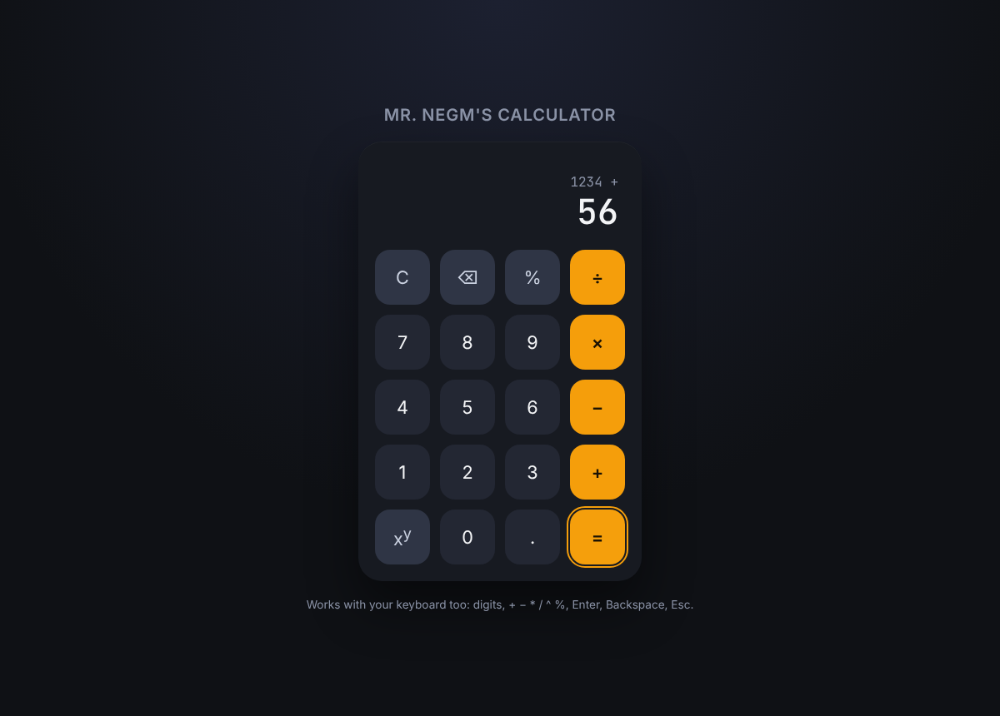

# Mr. Negm's Calculator

A calculator that runs in the browser, built with plain HTML, CSS and JavaScript with no libraries or build step.

**Live demo:** https://moenegm.github.io/calculator/



## Features

- Add, subtract, multiply, divide and raise to a power (`xʸ`)
- Percent works like a phone calculator: `50 %` gives `0.5`, and `200 + 10 %` gives `200 + 20`
- Chains operations, so `2 + 3 ×` shows `5` before you type the next number
- Backspace, clear, and a history line that shows the pending operation
- Full keyboard support: digits, `+ - * / ^ %`, `Enter`, `Backspace`, `Esc`
- Rounds away floating point noise (`0.1 + 0.2` shows `0.3`) and shows `Error` for divide by zero
- Works on phones and desktops

## How it works

`main.js` keeps the calculator's state (the number being typed, the stored number and the pending operator) and does the math on real numbers. It never builds a string and runs `eval()` on it, which the first version of this project did.

## Run it locally

Clone the repo and open `index.html` in a browser.

```sh
git clone https://github.com/moenegm/calculator.git
cd calculator
open index.html
```
